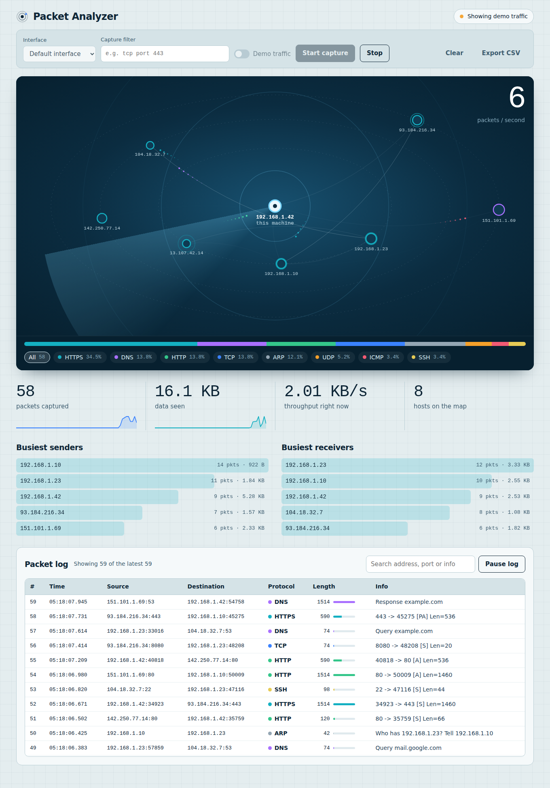

# Network Packet Analyzer

A small, Wireshark-style dashboard that captures network packets with **Scapy**, serves them through a **Flask** API, and shows live statistics in a browser.



## Features

- **Live traffic map**: your machine sits in the centre, other hosts orbit it, and every packet flies between them as a glowing comet coloured by its protocol. Hosts pulse when packets arrive and grow with the data they carry.
- Hover a host for its packet count and data; click it to filter the packet log to that address
- Protocol chips under the map double as filters for both the map and the log
- Live capture on any interface (TCP, UDP, DNS, HTTP/HTTPS, SSH, ICMP, ARP and more) with optional capture filters (BPF syntax, e.g. `tcp port 443`)
- Packet log with search, a size bar for each packet, and a pause button
- Click any packet to see its route drawn as a wire between source and destination, and highlighted on the map
- Summary numbers with sparklines, busiest senders and receivers, CSV export
- **Demo mode** that generates sample traffic, so you can try everything without admin rights
- Respects `prefers-reduced-motion`, works on phones, and is keyboard accessible

## Project structure

```
network-packet-analyzer/
├── backend/
│   ├── app.py              Flask server and API endpoints
│   ├── packet_capture.py   Captures packets and extracts fields using Scapy
│   ├── packet_store.py     Keeps recent packet summaries in memory, calculates statistics
│   └── requirements.txt    Python dependencies
├── frontend/
│   ├── index.html          Dashboard structure: controls, map, numbers, packet log
│   ├── style.css           Layout, colors, responsive design
│   └── script.js           Calls the API, animates the traffic map, filters rows
├── docs/
│   └── screenshot.png      Screenshot used in this README
├── README.md
└── .gitignore
```

## Requirements

- Python 3.9 or newer
- **Linux/macOS:** `libpcap` (usually already installed)
- **Windows:** [Npcap](https://npcap.com/) (install with "WinPcap API-compatible mode")
- Administrator/root rights for **live** capture (not needed for demo mode)

## Installation

```bash
git clone <your-repo-url>
cd network-packet-analyzer

python -m venv venv
source venv/bin/activate          # Windows: venv\Scripts\activate

pip install -r backend/requirements.txt
```

## Usage

Start the server from the project root:

```bash
# Live capture needs elevated rights
sudo venv/bin/python backend/app.py        # Linux/macOS
python backend\app.py                      # Windows: run the terminal as Administrator

# Demo mode only (no elevated rights)
python backend/app.py
```

Open **http://127.0.0.1:5000** in your browser, then:

1. Pick a network interface (or leave the default).
2. Optionally enter a capture filter such as `udp port 53`.
3. Click **Start capture**. No admin rights? Tick **Use demo traffic** first.

## API reference

| Method | Endpoint | Description |
|--------|----------|-------------|
| GET  | `/api/interfaces` | List network interfaces |
| GET  | `/api/capture/status` | Current capture state |
| POST | `/api/capture/start` | Body: `{"interface": "eth0", "filter": "tcp", "demo": false}` |
| POST | `/api/capture/stop` | Stop capturing |
| GET  | `/api/packets` | Query: `limit`, `protocol`, `search`, `after_id` |
| POST | `/api/packets/clear` | Clear stored packets and statistics |
| GET  | `/api/packets/export` | Download recent packets as CSV |
| GET  | `/api/stats` | Totals, rates, protocol mix, top talkers, 60s timeline |

## Troubleshooting

- **"Operation not permitted" / permission error:** run the server with `sudo` (Linux/macOS) or as Administrator (Windows).
- **No interfaces or no packets on Windows:** install Npcap and restart the terminal.
- **Filter error:** capture filters use BPF syntax and need `libpcap`/`tcpdump` on Linux.
- **Only a few packets shown:** the store keeps the most recent 2,000 packets in memory.

## Responsible use

Only capture traffic on networks you own or are explicitly authorized to monitor. This tool shows packet **summaries** (addresses, ports, sizes), not payload contents, and keeps data in memory only.

## Ideas for next steps

WebSocket streaming instead of polling, PCAP export, GeoIP lookup, anomaly alerts (port scans, traffic spikes).

## License

MIT
